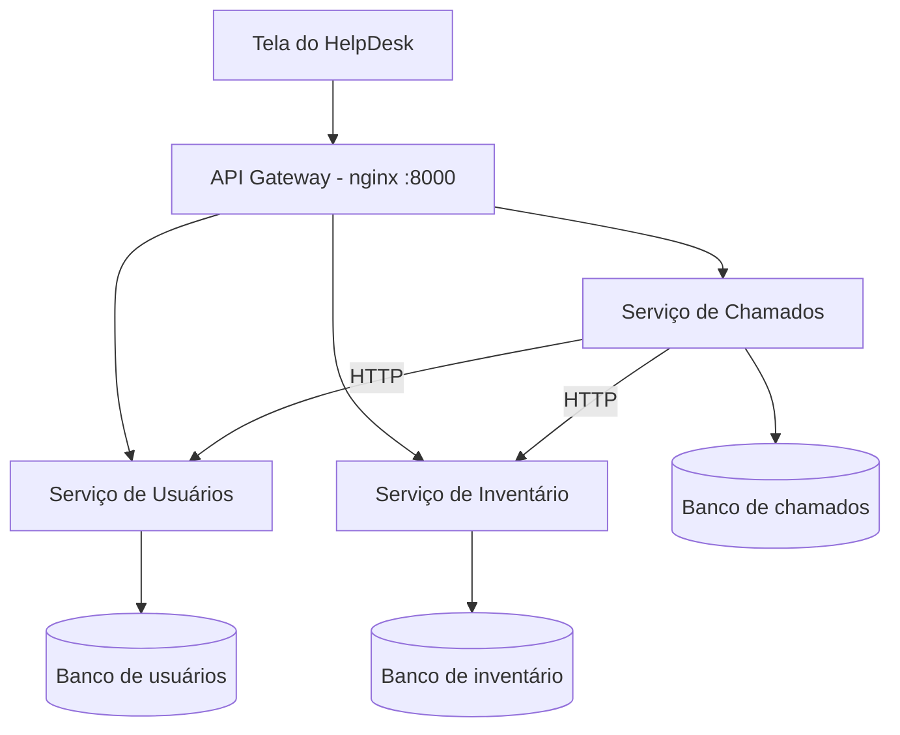

# HelpDesk TI: versão em microsserviços

**Disciplina:** Arquitetura de Software · **Prof. Filipe Cavalcante**
**Aluna:** Mariana Cecília

> **Vídeo de demonstração:** não será entregue.

O HelpDesk TI era um monólito (uma aplicação, um banco, uma implantação). Nesta versão ele foi dividido em três serviços independentes, cada um com seu banco, atrás de um API Gateway. Todas as funcionalidades continuam: abrir, atribuir, mudar status, comentar e ver o painel, com as mesmas regras de SLA e de transição de status.

## Arquitetura



| Serviço        | Responsabilidade                                                                          | Banco           |
| -------------- | ----------------------------------------------------------------------------------------- | --------------- |
| **gateway**    | Único ponto de entrada (porta 8000). Serve a tela e encaminha cada rota ao serviço certo. | nenhum          |
| **usuarios**   | Cadastro de usuários e login (emite o token JWT).                                         | `usuarios.db`   |
| **inventario** | Cadastro de equipamentos (ativos).                                                        | `inventario.db` |
| **chamados**   | Chamados, comentários, SLA, painel e notificações.                                        | `chamados.db`   |

### Rotas do gateway

| Rota                                                                | Serviço                             |
| ------------------------------------------------------------------- | ----------------------------------- |
| `/`                                                                 | Tela (arquivos estáticos)           |
| `/auth`, `/usuarios`                                                | usuarios                            |
| `/ativos`                                                           | inventario                          |
| `/chamados`, `/notificacoes`                                        | chamados                            |
| `/saude`, `/saude/usuarios`, `/saude/inventario`, `/saude/chamados` | Estado do gateway e de cada serviço |

## Como rodar

Pré-requisito: Docker com Docker Compose.

1. Copie o arquivo de exemplo e defina o segredo do token (mínimo de 32 caracteres):

   ```powershell
   Copy-Item .env.example .env
   ```

   Edite o `.env` e troque o valor de `JWT_SEGREDO`.

2. Suba tudo com um comando:

   ```powershell
   docker compose up --build
   ```

3. Abra **http://localhost:8000**.

Para conferir os contêineres: `docker compose ps`. Só o `gateway` publica porta.
Para recomeçar do zero (apaga os bancos): `docker compose down -v`.

### Contas de exemplo (senha `Helpdesk2026`)

| E-mail              | Perfil                                   |
| ------------------- | ---------------------------------------- |
| `carla@empresa.com` | técnica (fluxo completo)                 |
| `ana@empresa.com`   | solicitante (só vê os próprios chamados) |

## Decisões de projeto

**Um banco por serviço.** Cada serviço usa seu próprio arquivo SQLite em `/app/data`, com um volume Docker para cada um. Nenhum serviço lê ou grava no banco de outro. Não há chave estrangeira entre serviços: no `chamados`, `solicitante_id`, `tecnico_id`, `ativo_id` e `autor_id` são apenas números, e quem confere se existem é o código, por HTTP.

**Comunicação por HTTP.** O serviço de Chamados confere o equipamento (`GET /ativos/{id}`) e o técnico (`GET /usuarios/{id}`) chamando os outros serviços pelo nome da rede do Docker (`http://usuarios:8000`, `http://inventario:8000`).

**Tratamento de falhas.** Toda chamada entre serviços tem timeout (3 s no total e 2 s para conectar, configurável por `TIMEOUT_SEGUNDOS`). Se Usuários ou Inventário estiverem fora do ar, ou estourarem o tempo, o Chamados responde **503** com uma mensagem clara, sem travar. Listar chamados e o painel continuam funcionando, pois não dependem dos outros serviços.

**API Gateway com nginx.** Escolhido por ser simples: um arquivo de configuração (`gateway/nginx.conf`) encaminha as rotas e serve a tela. O cabeçalho `Authorization` passa direto, então a tela continua funcionando sem mudar de endereço.

**Notificações dentro do serviço de Chamados.** O módulo de notificações não virou um serviço separado: ele vive dentro do `chamados` e usa o banco dele. Os pontos onde seria publicado um evento (`ChamadoAberto`, `ChamadoAtribuido`, `ChamadoResolvido`) estão marcados no código. Separar em um serviço próprio, com fila de eventos, ficou como evolução futura.

**Login em um serviço só.** O serviço de Usuários faz o login e emite o token. Os outros dois apenas validam o token.

## Segurança

- **Token conferido em todos os serviços.** Cada serviço valida assinatura, emissor e expiração do JWT. Sem token, a resposta é **401**.
- **Segredo fora do código.** `JWT_SEGREDO` vem do `.env` (nunca commitado; só o `.env.example` vai para o repositório). Os três serviços usam o mesmo segredo e se recusam a iniciar se ele tiver menos de 32 caracteres.
- **Token repassado.** Ao chamar outro serviço, o Chamados repassa o `Authorization` do usuário.
- **Permissões por perfil mantidas.** O solicitante só vê, comenta e fecha os próprios chamados; técnico e admin veem todos, atribuem e mudam o status. Para quem não pode ver um chamado, a resposta é "não encontrado", sem revelar que ele existe.
- **Só o gateway fica exposto.** `usuarios`, `inventario`, `chamados` e os bancos não publicam portas para fora do Docker.
- **Cabeçalhos de segurança** (CSP, `X-Frame-Options`, `X-Content-Type-Options` e outros) nas respostas.

## O que mudou em relação ao monólito

- **Melhor:** cada serviço pode ser alterado, testado e publicado sozinho; uma falha em Usuários ou Inventário não derruba o resto; cada serviço é dono dos seus dados.
- **Mais difícil:** agora existe a rede no meio, então é preciso tratar timeout e indisponibilidade; não há mais transação única entre tabelas de serviços diferentes; a configuração (segredo, URLs, gateway) aumentou.

## Estrutura do repositório

```
usuarios/      serviço de Usuários (login e cadastro)
inventario/    serviço de Inventário
chamados/      serviço de Chamados (inclui notificações)
gateway/       configuração do nginx
app/web/       tela do HelpDesk, servida pelo gateway
docker-compose.yml
.env.example
```

## Não implementado (bônus)

Eventos em fila com serviço de Notificações separado e testes por serviço no GitHub Actions.
