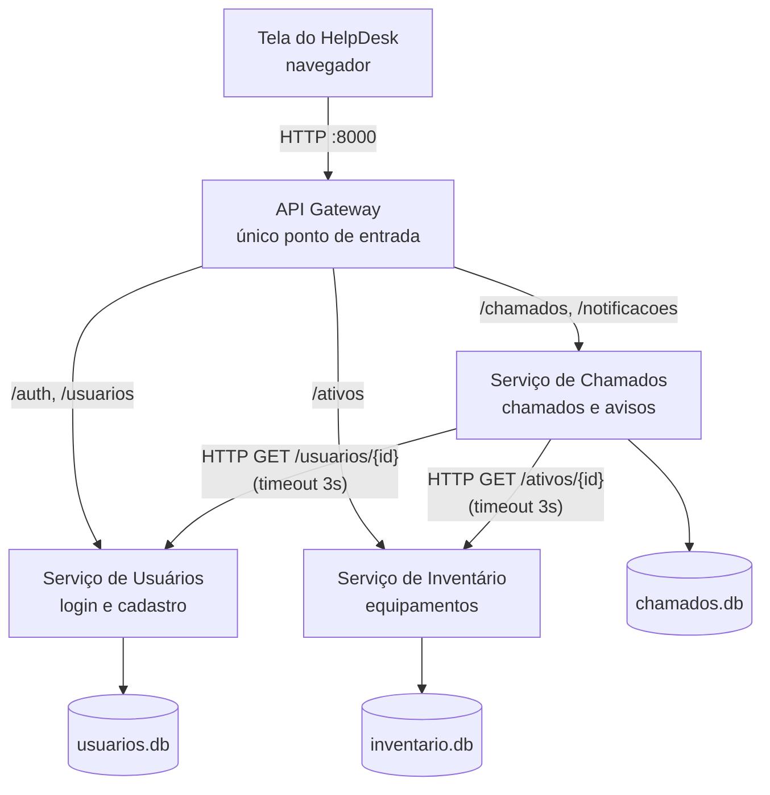
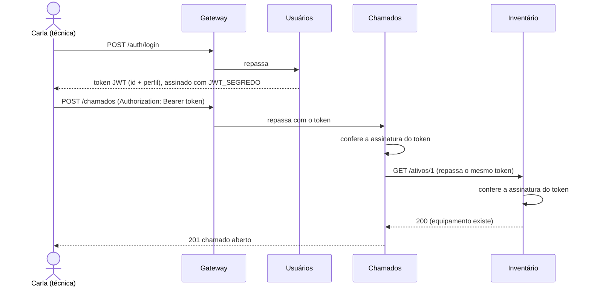

HelpDesk TI em microsserviços
Aluno: Erison Cavalcante · Disciplina: Arquitetura de Software · Prof. Filipe Cavalcante
🎥 Vídeo de demonstração: COLE_AQUI_O_LINK_DO_VIDEO

Sistema de chamados de TI (parecido com um GLPI simplificado), feito em Python + FastAPI.
Ele começou como um monólito (uma aplicação, um banco, uma implantação) e foi dividido em
microsserviços: cada parte do sistema virou um projeto próprio, com seu próprio contêiner e seu próprio banco.
Todas as funcionalidades continuam as mesmas: login, cadastro de usuários e equipamentos,
chamados com prazo de SLA, atribuição, mudança de status, comentários, notificações e painel.
Arquitetura

Serviço	Pasta	Rotas	Banco
Gateway	`servicos/gateway`	serve a tela (`/`) e repassa as rotas abaixo; `GET /saude` mostra quem está no ar	nenhum
Usuários	`servicos/usuarios`	`/auth/login`, `/auth/eu`, `/usuarios`	`usuarios.db`
Inventário	`servicos/inventario`	`/ativos`	`inventario.db`
Chamados	`servicos/chamados`	`/chamados`, `/chamados/painel`, `/notificacoes`	`chamados.db`
Cada serviço também tem `GET /saude`.
Como o login funciona entre os serviços

Como rodar
Pré-requisito: Docker com Docker Compose.
```bash
# 1. Crie o arquivo de configuração
cp .env.example .env

# 2. Gere o segredo dos tokens e cole no .env, na linha JWT_SEGREDO=
python3 -c "import secrets; print(secrets.token_urlsafe(48))"

# 3. Suba tudo
docker compose up --build
```
Abra http://localhost:8000. Contas de exemplo (senha `Helpdesk2026`):
E-mail	Perfil
`carla@empresa.com`	técnica (fluxo completo)
`diego@empresa.com`	técnico
`ana@empresa.com`	solicitante (só vê os próprios chamados)
`bruno@empresa.com`	solicitante
`admin@empresa.com`	administrador
Outros comandos úteis:
```bash
docker compose ps                    # ver os contêineres no ar
docker compose stop inventario       # simular a queda de um serviço
docker compose start inventario      # religar
docker compose down -v               # apagar tudo, inclusive os bancos
```
Testes
Cada serviço tem os próprios testes (inclusive os de segurança), que rodam no GitHub Actions a cada push,
um job por serviço. Para rodar localmente:
```bash
for s in usuarios inventario chamados gateway; do
  (cd servicos/$s && pip install -q -r requirements-dev.txt && python -m pytest -q) || break
done
```
Decisões tomadas
Separação aos poucos (padrão Strangler Fig). Separei um serviço por vez, com um commit para cada:
primeiro o Inventário (não depende de ninguém), depois Usuários, depois o Gateway e por último
Chamados. Enquanto Chamados ainda não estava separado, o gateway mandava `/chamados` para o monólito.
Assim a tela funcionou do começo ao fim do trabalho, e eu podia testar a cada passo.
Token JWT conferido em cada serviço. Só o serviço de Usuários cria tokens. O token leva o id e o
perfil do usuário e é assinado com `JWT_SEGREDO`. Os outros serviços conferem a assinatura sozinhos,
sem precisar perguntar ao serviço de Usuários a cada requisição.
Custo: se um usuário for desativado, o token dele continua valendo até expirar (60 minutos).
Segredo obrigatório e fora do código. O `JWT_SEGREDO` vem do `.env`, que não vai para o GitHub.
No monólito, sem o segredo, era gerado um aleatório a cada início. Com vários serviços isso quebraria
o login (cada um teria um segredo diferente), então agora nenhum serviço sobe sem ele.
Código de autenticação copiado em cada serviço. Preferi uma pequena duplicação (o `auth.py`) a uma
biblioteca compartilhada, para manter os serviços realmente independentes: cada um pode ser alterado e
publicado sozinho.
Sem chaves estrangeiras entre serviços. Chamados guarda só o `solicitante_id`, o `tecnico_id` e o
`ativo_id`. Quem confere se eles existem é o próprio serviço de Chamados, chamando os outros por HTTP na
hora de abrir ou atribuir o chamado. A chave estrangeira entre `comentarios` e `chamados` continua, porque
as duas tabelas estão no mesmo serviço.
Tratamento de falhas. As chamadas de Chamados para os outros serviços têm timeout de 3 segundos.
Se Usuários ou Inventário estiverem fora do ar ou lentos, Chamados responde 503 com uma mensagem clara
("O serviço de inventário está fora do ar") em vez de travar, e o resto continua funcionando
(listar chamados, abrir chamado sem equipamento, comentar). O gateway faz o mesmo (timeout de 5 segundos).
Repasse do token. Quando Chamados chama Usuários ou Inventário, ele repassa o token do usuário
(`Authorization`). Assim, os outros serviços também conferem quem está pedindo.
Gateway próprio em FastAPI + httpx. Ele escolhe o serviço pelo começo do caminho, repassa os
cabeçalhos e também serve a tela, que continua no mesmo endereço (porta 8000).
IP real no limite de tentativas de login. Atrás do gateway, todas as requisições chegariam com o IP
do gateway, e um único atacante poderia bloquear o login de todos. O gateway envia o IP real no cabeçalho
`X-Forwarded-For` (descartando o valor que veio do cliente, para ninguém falsificar) e o serviço de Usuários
lê esse cabeçalho (`--proxy-headers`).
Só o gateway fica exposto. No `docker-compose.yml`, apenas o gateway tem `ports:`. Os serviços e os
bancos só são acessíveis dentro da rede do Docker, onde se chamam pelo nome (`http://usuarios:8000`).
Todos os contêineres rodam sem root, com o sistema de arquivos somente leitura e sem privilégios extras.
Notificações dentro de Chamados. Os avisos (`ChamadoAberto`, `ChamadoAtribuido`, `ChamadoResolvido`)
continuam sendo gravados pelo serviço de Chamados, no banco dele.
Dados de exemplo com ids fixos. Cada serviço cria os próprios dados de exemplo. Como os chamados de
exemplo apontam para usuários e equipamentos de outros serviços, usei ids fixos (Ana = 2, Carla = 4,
desktop = 1...). Os chamados de exemplo são gravados direto no banco, sem chamar os outros serviços,
porque na hora em que o serviço sobe os outros podem ainda não estar no ar.
Testes sem subir os outros serviços. Os testes de Chamados trocam os serviços de Usuários e Inventário
por uma "rede falsa", que simula respostas, recurso inexistente, serviço fora do ar e lentidão (timeout).
O que mudou em relação ao monólito
	Monólito	Microsserviços
Implantação	tudo junto	cada serviço pode ser publicado sozinho
Banco	um só, com chaves estrangeiras	um por serviço, ligados só por ids
Conversa entre módulos	chamada de função	chamada HTTP pela rede
Se uma parte cai	cai tudo	só aquela parte fica indisponível
Login	confere no banco	cada serviço confere o token
Ficou melhor: cada time pode mudar e publicar o seu serviço sem mexer nos outros. Uma falha no Inventário
não derruba os chamados. Cada serviço pode ser escalado separadamente.
Ficou mais difícil: agora existe a rede no meio. Uma chamada pode demorar ou falhar, então foi preciso
tratar timeout e erro 503. Não existe mais chave estrangeira garantindo que um id existe. Há mais contêineres
para subir e monitorar. O segredo precisa ser o mesmo em todos os serviços. E depurar um erro exige olhar os
logs de vários serviços.
Segurança
O detalhamento das proteções está em SECURITY.md. Na versão em microsserviços:
todo serviço confere o token antes de responder (testado em cada um: token adulterado, assinado com outro
segredo, sem assinatura, vencido);
as permissões por perfil continuam valendo (o solicitante só vê os próprios chamados);
o token do usuário é repassado nas chamadas entre serviços;
só o gateway publica porta; os serviços e os bancos ficam dentro do Docker;
os segredos ficam no `.env`, fora do código.